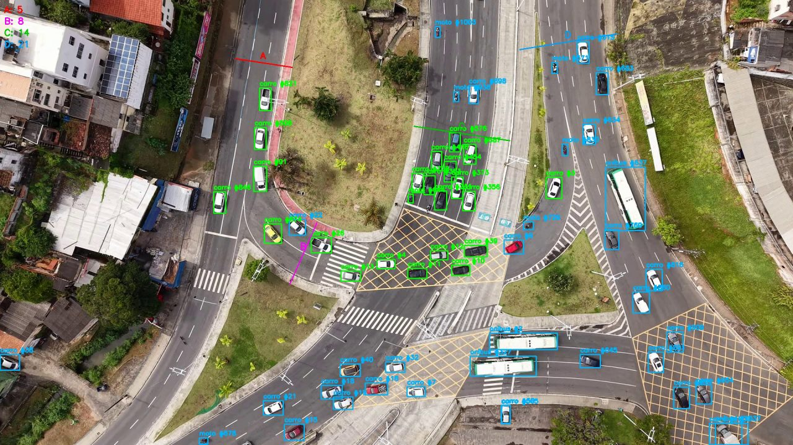
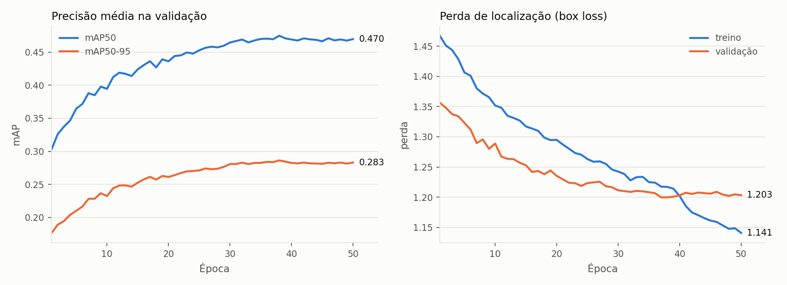

# Contagem de tráfego com drone e YOLO ajustado no VisDrone

Scripts em Python para contar veículos em vídeos de drone, classificados por tipo e sentido, em uma ou mais seções da via. O fluxo foi desenvolvido para a contagem de tráfego entregue à SEMOB-Salvador e cobre todas as etapas, desde o ajuste fino (*fine-tuning*) da rede YOLOv8 no dataset VisDrone até a exportação das contagens em CSV e do vídeo anotado.



## Por que ajustar a rede

Os pesos originais do YOLO foram treinados no COCO, um conjunto de fotografias tiradas do nível do solo. Em visada vertical (nadir), o veículo aparece como um retângulo de teto e a rede deixa de reconhecê-lo. No vídeo nadir deste projeto, o modelo COCO não produziu nenhuma detecção na pista principal. O VisDrone reúne imagens capturadas por drones, e o ajuste da rede nesse conjunto ensina o modelo a reconhecer veículos vistos de cima.

A contagem combina três etapas. O YOLO detecta os veículos em cada quadro, o ByteTrack atribui a cada um deles um identificador estável ao longo do vídeo (*tracking*) e a contagem acontece quando o centro de um identificador cruza o segmento desenhado pelo operador. Assim cada veículo é contado uma única vez por linha, e o sentido do cruzamento indica o sentido do fluxo.

## Mapa do repositório

| Arquivo ou pasta | Para que serve |
|---|---|
| `treinar_visdrone.py` | Ajuste fino do YOLOv8m no VisDrone (baixa o dataset na primeira execução) |
| `plotar_treino.py` | Gráfico de mAP e perda por época a partir do `results.csv` de um treino |
| `comparar_modelos.py` | Compara dois pesos VisDrone no conjunto de validação, nas mesmas condições |
| `escolher_linhas.py` | Janela interativa para desenhar várias linhas de contagem com o mouse |
| `contagem_trafego_nadir.py` | Contagem em vídeo nadir com os pesos ajustados no VisDrone |
| `contagem_trafego.py` | Contagem em vídeo oblíquo com os pesos COCO e núcleo geométrico da contagem |
| `recortar_video.py` | Recorta um trecho curto de um vídeo longo (gerou o vídeo de demonstração) |
| `baixar_assets.py` | Baixa da Release os pesos ajustados e o vídeo de demonstração |
| `exemplos/` | Coordenadas das linhas usadas no vídeo de demonstração |
| `resultados/treino_visdrone_y8m_50ep/` | Registro do treino que gerou os pesos publicados (métricas, parâmetros e gráficos) |
| `resultados/contagem_nadir_0178_completo/` | Contagem de referência do vídeo nadir completo (10 min) |

Vídeos, pesos (`.pt`) e o dataset não são versionados. Os pesos ajustados e um vídeo de 30 s estão anexados à [Release v1.0](https://github.com/pedreirajr/yolo_visdrone/releases/tag/v1.0).

## Passo a passo

### 1. Instalação

Recomenda-se Python 3.9 ou mais recente e um ambiente virtual.

```bash
git clone https://github.com/pedreirajr/yolo_visdrone.git
cd yolo_visdrone
python -m venv .venv
.venv\Scripts\activate          # Windows (no Linux/macOS, source .venv/bin/activate)
pip install -r requirements.txt
```

O treino e a contagem ficam muito mais rápidos com uma GPU NVIDIA. Nesse caso, instale antes o PyTorch com suporte a CUDA seguindo as instruções de [pytorch.org](https://pytorch.org/get-started/locally/). Os scripts foram testados com Ultralytics 8.4, PyTorch 2.8 (CUDA 12.6) e uma RTX 4070 de 8 GB.

### 2. Baixar os pesos e o vídeo de demonstração

```bash
python baixar_assets.py
```

O script cria `pesos/visdrone_y8m_50ep_best.pt` (cerca de 52 MB) e `videos/demo_nadir_30s.mp4` (cerca de 22 MB).

### 3. Rodar a contagem de demonstração

```bash
python contagem_trafego_nadir.py --video videos/demo_nadir_30s.mp4 ^
    --linha A 570 142 707 163 --linha B 701 690 767 540 ^
    --linha C 1002 306 1234 341 --linha D 1258 120 1493 82 ^
    --saida saidas/demo_nadir
```

No Linux/macOS, troque o `^` de continuação de linha por `\`. Os arquivos gerados em `saidas/` são estes:

- `demo_nadir_eventos.csv`, com um registro por cruzamento (quadro, tempo, identificador, classe, sentido e linha)
- `demo_nadir_resumo.csv`, com os totais por linha, classe e sentido
- `demo_nadir_anotado.mp4`, com as caixas, os identificadores e o placar de cada linha, para auditoria visual

O resultado esperado é o da tabela abaixo. É idêntico ao registrado na mesma janela (330 s a 360 s) pela contagem do vídeo completo.

| Linha | Carro | Caminhão | Ônibus | Moto | Total |
|---|---:|---:|---:|---:|---:|
| A | 5 | 2 | 0 | 0 | 7 |
| B | 13 | 0 | 0 | 0 | 13 |
| C | 12 | 0 | 0 | 5 | 17 |
| D | 26 | 1 | 3 | 5 | 35 |

### 4. Reproduzir o ajuste fino (opcional)

Esta etapa só é necessária para gerar os pesos de novo ou testar outras configurações. Na primeira execução, o Ultralytics baixa o VisDrone (cerca de 2 GB) para `datasets/`.

```bash
# teste de uma época, para medir o tempo na sua máquina
python treinar_visdrone.py --epochs 1 --nome teste_1ep

# ajuste completo com os parâmetros dos pesos publicados (50 épocas, imgsz 768, batch 4)
python treinar_visdrone.py

# curvas de treino
python plotar_treino.py --run runs/detect/visdrone_y8m_50ep

# ganho de 50 épocas em relação a uma
python comparar_modelos.py --a runs/detect/teste_1ep/weights/best.pt --nome-a 1_epoca ^
    --b runs/detect/visdrone_y8m_50ep/weights/best.pt --nome-b 50_epocas
```

O treino publicado levou cerca de 13,8 horas na RTX 4070. A figura abaixo foi gerada com `plotar_treino.py` a partir do registro guardado em `resultados/`.



O mAP50 na validação passa de 0,30 na primeira época para 0,47 na última, e o mAP50-95 chega a 0,286 na época 38. As métricas se estabilizam a partir da época 35, e a perda de validação também para de cair, o que indica que mais épocas trariam pouco ganho. A queda da perda de treino nas últimas dez épocas coincide com o desligamento do aumento de dados por mosaico (`close_mosaic: 10`), comportamento padrão do Ultralytics.

### 5. Contar nos seus próprios vídeos

1. Se o vídeo for muito longo para testes, recorte um trecho com `recortar_video.py` (sem `--largura`, as coordenadas continuam válidas para o vídeo original).
   ```bash
   python recortar_video.py --video "MEU_VIDEO.MP4" --inicio 300 --duracao 30 --saida videos/teste.mp4
   ```
2. Desenhe as linhas com `escolher_linhas.py`. Use `--tempo` para escolher um quadro com tráfego. Ao salvar (tecla `s`), o script imprime e grava os argumentos `--linha` prontos para colar.
   ```bash
   python escolher_linhas.py --video "MEU_VIDEO.MP4" --tempo 60
   ```
3. Rode a contagem com o script adequado ao ângulo da câmera:
   - visada vertical (nadir), `contagem_trafego_nadir.py`, que usa os pesos VisDrone por padrão
   - visada oblíqua, `contagem_trafego.py`, que usa os pesos COCO (`yolov8m.pt`, baixado automaticamente)

Algumas opções úteis dos dois scripts de contagem:

- `--imgsz` define a resolução de inferência (padrão 1280). Valores maiores ajudam com veículos pequenos e custam mais tempo
- `--conf` define a confiança mínima da detecção (padrão 0,25)
- `--video-ate-s 60` grava o vídeo anotado só no primeiro minuto, enquanto a contagem segue até o fim
- `--sem-video` dispensa o vídeo anotado e acelera o processamento
- `--processar-ate-s 30` (só no nadir) interrompe a contagem após 30 s, para testes rápidos

## Resultado de referência

A pasta `resultados/contagem_nadir_0178_completo/` guarda a contagem dos 10 minutos do vídeo nadir original, feita com os pesos publicados e as linhas de `exemplos/demo_nadir_linhas.txt`.

| Linha | Sentido | Carro | Caminhão | Ônibus | Moto | Bicicleta | Total |
|---|---|---:|---:|---:|---:|---:|---:|
| A | A→B | 74 | 5 | 6 | 15 | 0 | 100 |
| B | A→B | 49 | 0 | 2 | 9 | 0 | 60 |
| C | A→B | 378 | 11 | 15 | 87 | 1 | 492 |
| D | B→A | 478 | 18 | 14 | 84 | 1 | 595 |

## Limitações

- A classe "carro" agrega `car` e `van` do VisDrone. Para separá-las, edite `NOME_PARA_CATEGORIA` em `contagem_trafego_nadir.py`.
- Motos e bicicletas ocupam poucos pixels vistos do alto e tendem a ser subestimadas, sobretudo com os pesos COCO.
- As coordenadas das linhas são em pixels. Qualquer mudança de enquadramento ou de resolução exige escolher as linhas de novo.
- Trocas de identificador pelo rastreador (por oclusão, por exemplo) podem gerar contagens duplicadas ou perdidas. O vídeo anotado serve para auditar esses casos.

## Licença

O código é distribuído sob a licença [AGPL-3.0](LICENSE), a mesma do Ultralytics YOLOv8, do qual os pesos publicados são derivados. Os pesos foram ajustados no VisDrone, e quem for reutilizá-los deve consultar também os termos de uso desse dataset.

## Autor

Jorge Ubirajara Pedreira Junior
